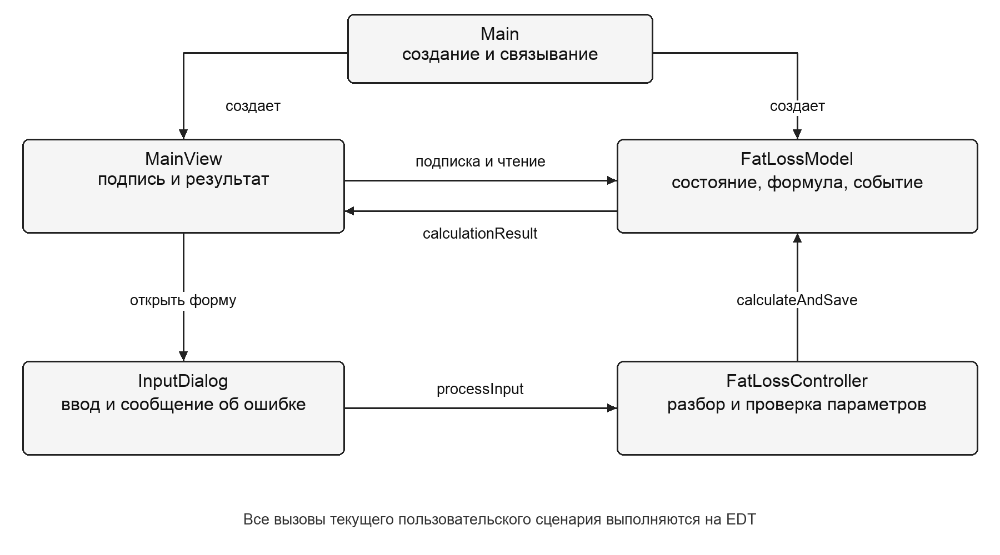
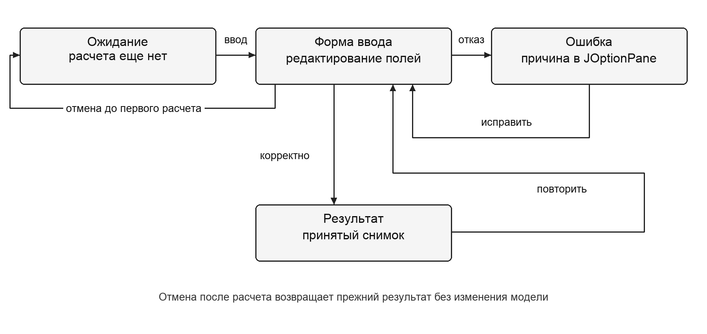

# Описание дизайна программного обеспечения

Для приложения «Идеальное похудение»

Версия 0.2 · Лапко М. А. · БГУИР · 19.11.2026

## История изменений

| Версия | Дата | Основание |
|---|---|---|
| 0.1 | 19.11.2026 | Архитектура существующего калькулятора по SRS 0.1 |
| 0.2 | 19.11.2026 | Учебные раунды планирования: FR-009 отложено, FR-010 предложено для следующего релиза |

## 1 Введение

### 1.1 Назначение документа

SDD объясняет, как реализуются требования [SRS](../srs/srs-template.md), и предназначен для разработчика и проверяющего. Базовая версия соответствует пяти классам в `src/main/java`. Планируемое расширение копирования результата выделено отдельно; оно пока отсутствует в коде.

### 1.2 Область применения

Локальное однопользовательское приложение Java Swing вычисляет два значения пульса по фиксированным интенсивностям. В область входят ввод, проверка, расчет, отображение, повторный ввод и отмена. Сервер, база данных, учетные записи и постоянная история не нужны. В следующем релизе предложено копирование результата по явной команде; встроенная справка отложена.

### 1.3 Термины

SRS — спецификация требований; SDD — описание проектирования; ADR — запись архитектурного решения; MVC — модель, представление, контроллер; EDT — поток обработки событий Swing; Viewpoint — правило рассмотрения системы; View — конкретное представление по этому правилу. Человеко-день — трудоемкость одного специалиста за рабочий день, а не календарная длительность команды.

### 1.4 Ссылки

Обязательная основа: [SRS](../srs/srs-template.md), [исходники](../src/main/java/). Проектные обоснования: [ADR](../adr/0001-swing-mvc.md), [план](../plan/plan.md), [сценарий переговоров](../plan/negotiations.md). Справочные: [EDT](https://docs.oracle.com/javase/tutorial/uiswing/concurrency/dispatch.html), [PropertyChangeSupport Java 21](https://docs.oracle.com/en/java/javase/21/docs/api/java.desktop/java/beans/PropertyChangeSupport.html), [Toolkit Java 21](https://docs.oracle.com/en/java/javase/21/docs/api/java.desktop/java/awt/Toolkit.html).

### 1.5 Обзор документа

Раздел 2 связывает интересы участников с точками зрения. Раздел 3 содержит семь представлений и ограничения реализации. Раздел 4 связывает требования с решениями. Раздел 5 указывает способы проверки и границы имеющихся свидетельств.

## 2 Обзор дизайна

### 2.1 Задачи участников

Пользователю нужны понятная форма, сохранение результата при ошибке и работа без сети. Разработчику нужны отдельные обязанности классов и предсказуемые уведомления. Проверяющему нужны связи SRS, кода и проектных решений. Заказчику в учебном сценарии нужны фиксированный срок и видимая цена изменения объема.

### 2.2 Выбранные точки зрения

| ID | Точка зрения | Интерес и форма представления |
|---|---|---|
| V1 | Контекст | Граница локальной программы; описание акторов |
| V2 | Композиция | Обязанности пяти классов; схема MVC |
| V3 | Информация и алгоритм | Состояние сеанса, формула и инварианты |
| V4 | Интерфейс | Контракты вызовов и сообщения об ошибках |
| V5 | Взаимодействие | Порядок операций при успешном и ошибочном вводе |
| V6 | Динамика состояний | Ожидание, форма, ошибка, результат, отмена |
| V7 | Развертывание и параллелизм | Один JVM-процесс, EDT, JDK 21, отсутствие сервера |

Выбор достаточен для размера приложения. Отдельные представления сетевых маршрутов и реляционной схемы не создаются: таких элементов в системе нет.

## 3 Проектные представления

### V1 Контекст

Единственный актор — пользователь настольной ОС. Он вводит возраст, пульс покоя и тренажер, получает результат и исправляет ввод. Среда — JVM и оконная система. Внешних сервисов нет. Будущее копирование FR-010 добавляет границу с системным буфером обмена; это явная передача данных из процесса по команде пользователя, а не фоновая отправка.

### V2 Композиция

`Main` создает объекты и связывает их. `MainView` показывает принятые данные и подписывается на модель. `InputDialog` содержит редактируемый ввод и отображает ошибку. `FatLossController` разбирает строки и проверяет ограничения. `FatLossModel` хранит принятый снимок, считает результат и уведомляет слушателей. Модель не импортирует Swing; представление знает модель и контроллер. Текущая реализация находится в пакете по умолчанию; дополнительные сервисы или репозитории не вводятся.

### V3 Информация и алгоритм

Состояние `FatLossModel`: `lastAge`, `lastRestingPulse`, `lastEquipment`, `startPulse`, `targetPulse`. Значения подстановки после запуска: 30, 60, BIKE. Начальные численные поля результата равны нулю, но GUI показывает «Данные еще не введены»; эти нули не являются выполненным расчетом. `Equipment` содержит BIKE, STEP, ROWING, ELLIPTICAL и русские названия.

Входной контракт: целые A от 1 до 120, R от 30 до 120, R < 220 − A, E не null. Контроллер применяет `trim` и `Integer.parseInt`, затем проверки до вызова модели. Пусть M = 220 − A, Q = M − R. H50 = round(R + 0,50Q), H70 = round(R + 0,70Q). Например, A=30, R=60 дает M=190, Q=130, H50=125, H70=151. Тренажер не меняет коэффициенты.

Инвариант гарантируется при входе через контроллер. Публичный `calculateAndSave` сам не валидирует параметры; новый код должен соблюдать его предусловия. В текущем однопоточном сценарии проверка завершается до записи, а уведомление идет после обновления всех пяти полей. Ошибка и отмена оставляют принятый снимок без изменения. База данных и сериализация отсутствуют.

### V4 Интерфейс

| Операция | Контракт |
|---|---|
| `processInput(String, String, Equipment)` | При корректном вводе вызывает модель; при отказе бросает NumberFormatException с русским сообщением |
| `calculateAndSave(int, int, Equipment)` | Принимает уже проверенные параметры, обновляет снимок и результаты |
| `addPropertyChangeListener(listener)` | Регистрирует наблюдателя модели |
| `propertyChange(event)` | MainView реагирует только на имя calculationResult и читает геттеры |
| `InputDialog.submit(controller)` | Закрывает форму после успеха; при исключении показывает JOptionPane и сохраняет форму |

Событие `calculationResult` передается с oldValue=null и строкой `startPulse:targetPulse` в newValue. MainView не разбирает эту строку: получает значения из модели. Null предотвращает подавление уведомления при повторном расчете с одинаковыми числами, включая смену тренажера. Отмена и закрытие формы вызывают `dispose`, не обращаясь к контроллеру.

Планируемый FR-010: кнопка копирования недоступна до первого успешного расчета; текст содержит параметры, тренажер, оба значения с единицами и учебное назначение. После ошибки или отмены доступен прежний результат. При занятости или недоступности буфера выводится сообщение, модель остается прежней. Выбор стандартного API описан в ADR-0004; нового кода еще нет.

### V5 Взаимодействие

1. Main через `SwingUtilities.invokeLater` создает модель, контроллер и главное окно.
2. MainView регистрирует себя слушателем и открывает модальную InputDialog по кнопке.
3. InputDialog подставляет геттеры последнего принятого ввода; изменения полей пока не меняют модель.
4. Команда расчета передает строки контроллеру. При отказе InputDialog показывает ошибку; диалог остается открыт, уведомления нет.
5. При успехе модель обновляет поля и вызывает слушателя. MainView обновляет подпись и результат, затем InputDialog закрывается.
6. Повторный ввод использует последний принятый снимок. Отмена закрывает диалог без вызова расчета.

### V6 Динамика состояний

Состояния описывают наблюдаемое поведение GUI, а не отдельный enum в программе. Начало → ожидание. Ожидание или результат → форма. Неверный ввод → сообщение об ошибке → та же форма. Корректный ввод → результат. Отмена → предыдущее состояние главного окна. Повторный выбор тренажера всегда обновляет подпись. При закрытии приложения снимок сеанса теряется.

### V7 Развертывание и параллелизм

Один JVM-процесс на macOS, Windows или Linux с графической средой и JDK 21. Из корня: `javac -encoding UTF-8 -d out src/main/java/*.java`; запуск: `java -cp out Main`. Нужен модуль java.desktop. `out/` не поставляется в Git. Сервер, контейнеры и миграции не предусмотрены.

Создание окон и обработчики выполняются на EDT. PropertyChangeSupport не переносит вызов слушателя на EDT автоматически; текущий путь безопасен, поскольку расчет вызывается из обработчика Swing. Многопоточность и фоновые задачи не нужны для короткой формулы. Долгую будущую операцию нельзя добавлять в обработчик без пересмотра решения. Минимум главного окна — 680 × 350 логических пикселей; целевое окружение требования отклика — Java 21 и ОЗУ от 4 ГБ. Лимит 1 с остается критерием приемки, а не измеренным результатом.

## 4 Решения и трассируемость

| Требования | Представления | Решение | Свидетельство |
|---|---|---|---|
| FR-001, FR-004, NFR-004, NFR-005, NFR-007 | V1, V2, V7 | [ADR-0001](../adr/0001-swing-mvc.md) | Main, MainView, InputDialog; снимки ЛР3 |
| FR-002, FR-003, FR-007, NFR-006 | V3, V4, V5 | [ADR-0003](../adr/0003-model-events.md) | processInput, calculateAndSave |
| FR-005, FR-008, NFR-001, NFR-002 | V3, V5, V6 | [ADR-0002](../adr/0002-session-state.md) | Поля модели; отмена через dispose |
| FR-006 | V2, V4, V5 | ADR-0003 | oldValue=null; чтение геттеров |
| FR-009 | V1 | [Раунд 1](../plan/negotiations.md) | Deferred; реализации нет |
| FR-010, проект NFR-002 | V1, V4, V7 | [ADR-0004](../adr/0004-clipboard.md) | Proposed; проект следующего релиза |

## 5 Приложения и проверка

Исходные снимки ЛР3: [форма](../images/app-input.png), [результат](../images/app-result.png). Новые схемы — проектные представления, не скриншоты программы. [План](../plan/plan.md) моделирует оценку полного объема; он не является табелем фактических затрат уже написанного кода. [Сценарий](../plan/negotiations.md) предназначен для ролевой игры и не подтверждает переговоры с реальным заказчиком.

Приемка предусматривает инспекцию зависимостей MVC, порядка валидации и уведомления, демонстрацию ошибки/отмены/повторного ввода, измерение отклика и сборку на целевых ОС. В ЛР4 код не изменен; тесты не добавлялись и не запускались. Переносимость Windows/Linux и время отклика не подтверждены. FR-010 потребует отдельной реализации и проверки буфера обмена.
