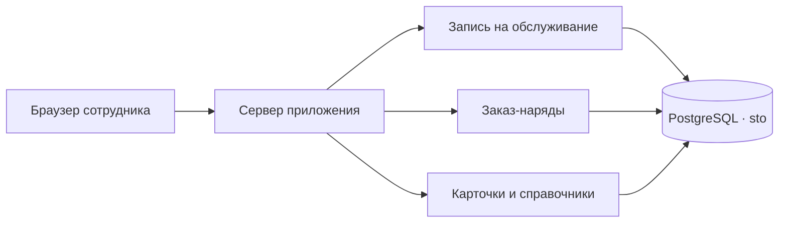
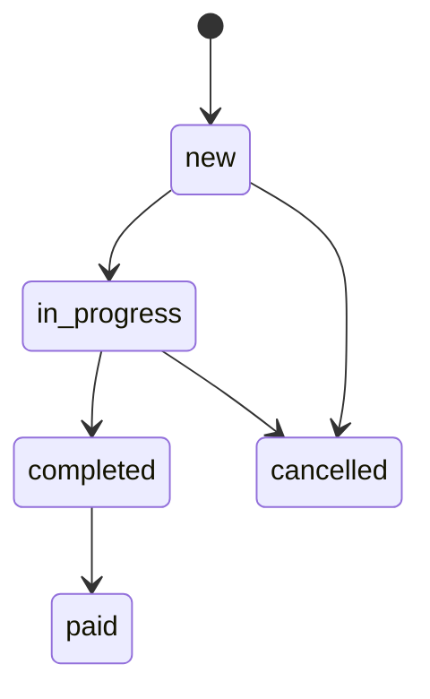

# Описание проектирования ПО «СТО»

| Версия | Изменение |
| --- | --- |
| 0.1 | Базовое проектирование по существующей реляционной модели СТО |
| 0.2 | Уведомления отложены. Предложен PDF сохранённого заказ-наряда |

## 1. Введение

SDD описывает устройство первого выпуска для разработчиков и проверяющего. Цель — реализовать [SRS](../srs/srs-template.md) поверх [схемы PostgreSQL](../src/main/sql/01_create_schema.sql). Учебный шаблон основан на [IEEE 1016-2009](https://standards.ieee.org/ieee/1016/4502/), терминология представлений — на [ISO/IEC/IEEE 42010:2022](https://www.iso.org/standard/74393.html).

## 2. Обзор дизайна

Приёмщику важны свободные интервалы, мастер ведёт состояние и состав заказа, разработчику нужны границы сервисов и правила конкурентного доступа. Точка зрения задаёт интересы и способ описания. Представление показывает систему с этой точки зрения.

## 3. Проектные представления

### V1. Контекст

Приёмщик и мастер работают через внутреннее веб-приложение. Клиент общается с приёмщиком. В планируемом первом выпуске нет прямого подключения клиентов к системе.

### V2. Композиция

### V3. Данные

Автомобиль и пост связаны с `service_appointment`. Заказ-наряд `service_order` связан с записью, клиентом и рабочим местом. `automobile_fault` связывает автомобиль с типом неисправности, а `service_order_part` — наряд с деталью. Последняя хранит цену на момент оформления и проверяет стоимость строки. Частичный уникальный индекс разрешает максимум один заказ со статусом `new` или `in_progress` на рабочее место.

### V4. Интерфейсы

Операции приложения: поиск карточки по VIN, сохранение записи с постом и интервалом, создание наряда, изменение статуса, добавление детали, получение PDF по номеру сохранённого наряда. При конфликте записи интерфейс сообщает, что интервал занят. Невалидный переход состояния отклоняется до изменения данных. PDF использует сохранённый снимок номера, данных клиента и автомобиля, работ, запчастей и итогов.

### V5. Взаимодействие

Сервер проверяет интервал, открывает транзакцию с уровнем READ COMMITTED и блокирует строку поста через `FOR UPDATE`. Отдельным запросом он ищет записи с условием `existing.start < requested.end AND requested.start < existing.end` для этого поста и даты. При переносе исключает текущую запись, блокирует старый и новый посты в порядке идентификаторов и выполняет проверку для целевого поста. При конфликте транзакция завершается без записи, иначе изменение сохраняется. Протокол действует на всех прикладных путях записи. Текущее DDL ограничивает совпадение времени начала, а полную проверку интервалов описывает ADR-0002.

### V6. Динамика состояний

Приложение проверяет переход и сохраняет стоимость в одной транзакции. Ограничения DDL проверяют допустимость самого значения статуса и нулевую стоимость при отмене.

### V7. Развёртывание

Браузер сотрудника обращается к серверу по HTTPS во внутренней сети. Только сервер приложения подключается к PostgreSQL. Изменения записываются транзакциями. Для проверки отклика используется стенд с условиями NFR-003.

## 4. Решения и трассировка

| Требования | Представления | Решение или проверка |
| --- | --- | --- |
| FR-001, FR-002, FR-004, FR-005, NFR-004 | V2, V3, V4, V7 | [ADR-0001](../adr/0001-postgresql.md) |
| FR-003, NFR-001 | V4, V5 | [ADR-0002](../adr/0002-appointment-locking.md) |
| FR-006 | V3, V6 | [ADR-0003](../adr/0003-order-states.md) |
| FR-007 | V1 | Отложено, план 0.2 |
| FR-008 | V4 | [ADR-0004](../adr/0004-order-pdf.md) |
| NFR-002, NFR-003 | V1, V2, V7 | Проверка доступа и замер отклика |

## 5. Связанные материалы

[Требования и приёмка](../src/requirements.md), [планы и зависимости](../plan/plan.md), [обсуждение](../plan/negotiations.md).
