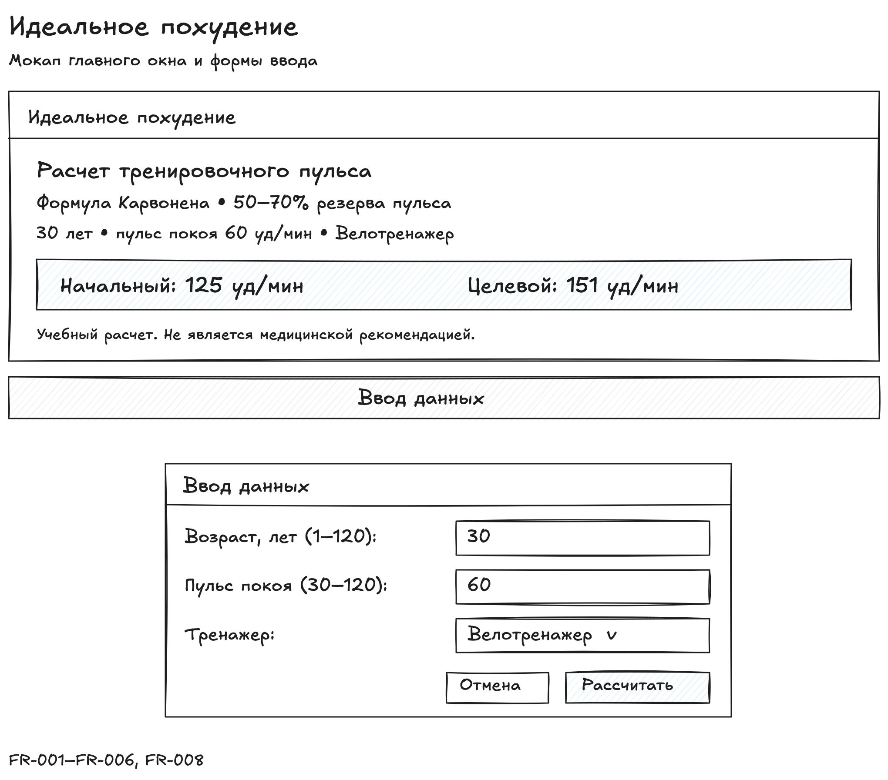
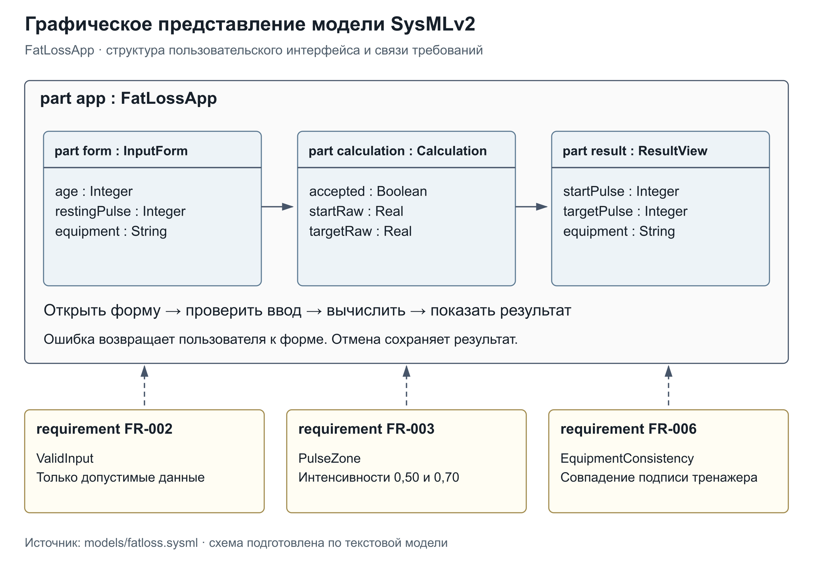

# Спецификация требований к ПО

Для приложения «Идеальное похудение»

Версия 0.1 · 17 ноября 2026 г.
Автор: Лапко М. А., группа 450504, БГУИР.
Статус: подготовлена к рассмотрению преподавателем. Базис — задание варианта 17 и приложение из ЛР1. Утверждение заказчиком не заявляется.

## 1. Введение

### 1.1 Назначение документа

SRS фиксирует назначение, границы и проверяемые требования к учебному настольному калькулятору тренировочного пульса. Документ используется для обсуждения интерфейса и как основа проектирования в ЛР4. Идентификаторы BR, FR и NFR позволяют связывать цели, функции, модель и реализацию.

### 1.2 Область применения продукта

Пользователь вводит возраст, пульс покоя и выбирает тренажер. Программа вычисляет два значения по формуле Карвонена: для 50% и 70% резерва пульса. Особенность калькулятора — сохранение последних принятых параметров в пределах сеанса и явное отображение исходных данных рядом с результатом.

Бизнес-цели:

| ID | Цель | Критерий достижения |
|---|---|---|
| BR-001 | Убрать необходимость вручную выполнять расчет по двум интенсивностям | После отправки одной формы отображаются оба значения с единицами измерения |
| BR-002 | Снизить вероятность ошибки ввода и чтения результата | Допустимые диапазоны подписаны; неверные данные отклоняются; исходные параметры видны в результате |
| BR-003 | Обеспечить простой повторный расчет без регистрации и сети | Форма содержит последние принятые значения; внешние сервисы не требуются |

В границы версии входят расчет, валидация, повторный ввод и отображение результата. За границами: медицинская диагностика, обещание снижения веса, подбор тренировочной программы, учет заболеваний, чтение датчиков, учет калорий, регистрация, история между запусками и облачная синхронизация. Название продукта не означает доказанную эффективность похудения.

### 1.3 Определения, акронимы и сокращения

SRS — спецификация требований к программному обеспечению. GUI — графический интерфейс пользователя. MVC — модель, представление, контроллер. ЧСС — частота сердечных сокращений. BR — бизнес-цель, FR — функциональное требование, NFR — нефункциональное требование. Мокап — статический макет интерфейса. SysMLv2 — язык системного моделирования; его модель и мокап имеют разные назначения.

### 1.4 Ссылки

1. Методические указания «Лабораторная работа №3. Разработка и документирование бизнес-требований», предоставлены по дисциплине ЖЦРПО.
2. [Исходный шаблон SRS](https://github.com/LeisuredRainbow/SDLC/blob/main/srs/srs-template.md).
3. [Официальные материалы SysMLv2](https://github.com/Systems-Modeling/SysML-v2-Release), в том числе раздел Requirements и примеры моделей.
4. [Документация Java Swing](https://docs.oracle.com/javase/tutorial/uiswing/).
5. [Исходный код приложения](../src/main/java/).

### 1.5 Обзор документа

Раздел 2 описывает продукт и его границы. Раздел 3 содержит требования к интерфейсу, поведению и качеству. Раздел 4 задает способы проверки и имеющиеся свидетельства. Раздел 5 содержит сценарии, графические материалы и связи требований с кодом.

## 2. Обзор продукта

### 2.1 Перспектива продукта

Самостоятельное однопользовательское Desktop-приложение на Java Swing. Сервер, база данных и подключение к Интернету не нужны. За основу взят калькулятор варианта 17 из ЛР1, размещенный в учебном репозитории ЛР2. Детальная архитектура и решения ADR относятся к следующей работе.

### 2.2 Функции продукта

Ввод параметров; выбор одного из четырех тренажеров; проверка ввода; вычисление двух значений пульса; показ исходных данных и результата; повторный ввод; отмена без изменения результата.

### 2.3 Ограничения продукта

Возраст — целое число от 1 до 120 лет, пульс покоя — целое число от 30 до 120 уд/мин. Дополнительно пульс покоя должен быть меньше 220 минус возраст. Эти границы являются ограничениями учебного ввода, а не медицинскими критериями допуска к нагрузке. Округление производится отдельно для каждого результата до ближайшего целого по правилам Math.round для положительных чисел.

Тренажеры: велотренажер, степ-тренажер, гребной тренажер, эллипсоид. Выбор влияет на подпись результата, но не меняет коэффициенты формулы.

### 2.4 Характеристики пользователей

Основной пользователь умеет вводить числа и пользоваться выпадающим списком. Для работы с калькулятором не требуется знание формулы. Преподаватель рассматривает требования и демонстрацию. Разработчик поддерживает согласованность SRS, модели и кода.

### 2.5 Допущения и зависимости

Возраст и пульс пользователь вводит самостоятельно; измерение пульса не выполняется. На компьютере доступна графическая среда и Java 21. Формула и коэффициенты заданы учебным проектом и сохраняются из ЛР1. Запрос на изменение границ или формулы требует согласования и обновления SRS.

### 2.6 Распределение требований

Must: FR-001–FR-008 и NFR-001, NFR-002, NFR-004, NFR-006, NFR-007. Should: измерить NFR-003 и подтвердить NFR-005 на целевых ОС до объявления полной переносимости. История расчетов и интеграция датчиков не входят в эту версию.

## 3. Требования

### 3.1 Внешние интерфейсы

#### 3.1.1 Пользовательские интерфейсы

Главное окно содержит название расчета, описание интенсивности, исходные параметры, область результата, уведомление об учебном назначении и кнопку «Ввод данных». Модальная форма содержит поля возраста и пульса, список тренажеров, кнопки «Отмена» и «Рассчитать». Ошибка показывается отдельным сообщением; форма остается доступной для исправления.

[Исходник Excalidraw](../images/ui-mockup.excalidraw). [Редактируемый SVG](../images/ui-mockup.svg). [Состояния интерфейса](../images/ui-states.png).

#### 3.1.2 Аппаратные интерфейсы

Используются стандартные экран, клавиатура и указательное устройство компьютера. Пульсометр и тренажер аппаратно не подключаются.

#### 3.1.3 Программные интерфейсы

GUI использует Java Swing/AWT; уведомление представления — PropertyChangeSupport. Внешние API, сетевые протоколы, импорт и экспорт данных в версию не входят.

### 3.2 Функциональные требования

| ID | Требование | Приоритет | Связь |
|---|---|---|---|
| FR-001 | Из главного окна должна открываться модальная форма с возрастом, пульсом покоя и выбором одного из четырех тренажеров. При первом открытии: 30 лет, 60 уд/мин, велотренажер | Must | BR-001 |
| FR-002 | Перед расчетом должны удаляться крайние пробелы, проверяться целочисленный формат, возраст 1–120, пульс 30–120, пульс меньше 220 − возраст и наличие тренажера | Must | BR-002 |
| FR-003 | При допустимом вводе должны вычисляться H50 = round(R + (220 − A − R) × 0,50) и H70 = round(R + (220 − A − R) × 0,70), где A — возраст, R — пульс покоя | Must | BR-001 |
| FR-004 | После успешного расчета форма должна закрываться, а главное окно — показывать возраст, пульс покоя, тренажер и оба результата с единицей «уд/мин» | Must | BR-001, BR-002 |
| FR-005 | При повторном открытии формы должны подставляться последние успешно принятые параметры текущего сеанса. После перезапуска используются начальные значения | Must | BR-003 |
| FR-006 | Смена только тренажера должна обновлять подпись результата, даже если численные значения пульса не изменились. Тренажер не влияет на арифметику | Must | BR-002 |
| FR-007 | При ошибке должно показываться понятное русскоязычное сообщение о причине; форма и введенные значения сохраняются, принятые параметры и прошлый результат не меняются | Must | BR-002 |
| FR-008 | Кнопка «Отмена» или закрытие формы должны завершать ввод без изменения принятых параметров и результата | Must | BR-003 |

### 3.3 Качество обслуживания

#### 3.3.1 Производительность

NFR-003: на целевой машине после запуска приложения результат должен появляться не позднее 1 с после команды «Рассчитать». Целевое окружение для измерения: Java 21, настольная ОС, не менее 4 ГБ ОЗУ. Лимит — требование, а не заявленный результат измерения; замер пока не выполнен.

#### 3.3.2 Безопасность

NFR-002: возраст, пульс и выбранный тренажер должны храниться только в оперативной памяти сеанса; приложение не должно отправлять их по сети или записывать в файл. Учетные записи и авторизация не требуются.

#### 3.3.3 Надежность

NFR-006: отказ проверки ввода не должен изменять последнее принятое состояние модели. Следующий корректный ввод должен быть возможен без перезапуска приложения. Проверка выполняется до изменения модели.

#### 3.3.4 Доступность

NFR-001: все заявленные функции должны работать без подключения к сети и внешних сервисов. Требования к круглосуточному серверному SLA неприменимы: приложение локальное.

#### 3.3.5 Наблюдаемость

Ошибка должна сообщаться в GUI по FR-007. Сбор телеметрии и ведение журнала персональных параметров не предусматриваются. Текущие принятые параметры видны рядом с результатом.

### 3.4 Соответствие стандартам

SRS оформляется по структуре учебного шаблона, отчет — по применяемому в БГУИР СТП и принятому образцу отчета. Это не заявление о сертификации программы. NFR-007: на главном экране должно постоянно отображаться указание «Учебный расчет. Не является медицинской рекомендацией».

### 3.5 Проектирование и реализация

#### 3.5.1 Установка

Java 21 и графическая среда ОС. Запуск из каталога репозитория: `javac -encoding UTF-8 -d out src/main/java/*.java`, затем `java -cp out Main`.

#### 3.5.2 Сборка и поставка

Исходный код, SRS, `.sysml`, редактируемые SVG и PNG хранятся в Git. Сборка использует только стандартную библиотеку Java; Maven, Gradle и сторонние библиотеки не требуются. Создаваемые `.class` и `out/` исключены через `.gitignore`.

#### 3.5.3 Распределение

Поставка учебного проекта — через репозиторий https://github.com/hromers/SDLC. Версия требований фиксируется коммитом; обсуждение изменений ведется в PR ветки lab3.

#### 3.5.4 Сопровождаемость

Каждое изменение поведения должно отражаться в соответствующих FR/NFR и, при необходимости, мокапе или модели. Расчет, проверка ввода и представление сохраняют отдельные обязанности MVC. Детализация SDD не включается в SRS.

#### 3.5.5 Повторное использование

Расчет из FatLossModel не должен зависеть от элементов GUI. Замена Swing в будущем не должна требовать изменения самой формулы; другая платформа не входит в текущую поставку.

#### 3.5.6 Переносимость

NFR-005: исходники должны собираться на Java 21 без платформенных API и сторонних библиотек для macOS, Windows и Linux. Фактически сборка и демонстрация выполнены на macOS; работа на Windows/Linux требует отдельного подтверждения.

NFR-004: интерфейс должен быть русскоязычным; подписи и результат должны читаться без обрезки при минимальном размере главного окна 680 × 350 логических пикселей. Размер формы определяется предпочтительными размерами Swing-компонентов.

#### 3.5.7 Стоимость

Платные внешние сервисы и подписки не предусмотрены. Денежный бюджет заказчиком не задан. Основной ограниченный ресурс учебного проекта — время на реализацию и согласование изменений.

#### 3.5.8 Сроки

Этап ЛР3: спецификация, модель, мокапы, реализация и материалы демонстрации. Следующий этап ЛР4: SDD и ADR после получения методических указаний. Конкретная дата приемки не задана.

#### 3.5.9 Доказательство концепции

Имеющееся Swing-приложение демонстрирует открытие формы и расчет для A = 30, R = 60: H50 = 125, H70 = 151 уд/мин. Реальные снимки находятся в `images/app-*.png`. Наличие снимков не заменяет измерение производительности или подтверждение переносимости.

#### 3.5.10 Управление изменениями

Изменение оформляется в PR: причина, затронутые ID, изменение критериев приемки и влияние на объем работы. После решения обновляются SRS, графические материалы и код, выполняется коммит Conventional Commits. Удаление или перенос требования требует явного решения. Отзыв напарника не является обязательным по уточнению автора задания; согласование преподавателем отдельно не подменяется самооценкой разработчика.

### 3.6 ИИ/МО

ИИ и машинное обучение в продукте не используются. Подразделы 3.6.1–3.6.6 (модель, данные, ограничители, этика, участие человека, жизненный цикл ML) неприменимы. Расчет детерминирован и задается FR-003.

## 4. Верификация

Автоматические тесты не добавлялись и не запускались. В таблице разделены имеющиеся свидетельства и проверки, которые еще предстоит провести при приемке.

| Требование | Метод | Свидетельство / критерий | Состояние |
|---|---|---|---|
| FR-001, FR-004 | Демонстрация GUI | [Форма](../images/app-input.png), [результат](../images/app-result.png) | Снимки получены |
| FR-003 | Анализ формулы и демонстрация | A=30, R=60 → 125 и 151; FatLossModel.calculateAndSave | Показан один расчет |
| FR-002, FR-007 | Инспекция кода | FatLossController.processInput проверяет формат и границы до изменения модели; InputDialog сохраняет форму при исключении | Код рассмотрен; отрицательные сценарии GUI не зафиксированы |
| FR-005, FR-008 | Инспекция кода | Геттеры последних значений; dispose без processInput при отмене | Код рассмотрен |
| FR-006 | Инспекция кода | Событие calculationResult отправляется с oldValue=null, поэтому одинаковые численные значения не подавляют уведомление | Код рассмотрен; отдельный снимок смены тренажера не получен |
| NFR-001, NFR-002 | Инспекция исходников | Нет сетевых вызовов и файлового сохранения пользовательских параметров | Код рассмотрен |
| NFR-004, NFR-007 | Осмотр GUI | [Начальное окно](../images/app-start.png), форма и результат | Показано на macOS |
| NFR-006 | Инспекция порядка операций | Все проверки контроллера предшествуют calculateAndSave | Код рассмотрен |
| NFR-003 | Измерение | Не более 1 с в указанном окружении | Не измерено |
| NFR-005 | Сборка на целевых ОС | Java 21, macOS / Windows / Linux | macOS собрана; Windows/Linux не подтверждены |

Критерии для дальнейшей приемки: возраст 1 и 120, пульс 30 и 120 принимаются только при выполнении условия R < 220 − A; пустое поле, дробь, буквы, выход за границу и R = 220 − A отклоняются. Для A=120, R=100 расчет должен быть отклонен. При A=31, R=60 ожидаются 125 и 150: проверяется округление 124,5 и 150,3. Для повторного выбора другого тренажера при A=30, R=60 числа должны оставаться 125 и 151, а подпись — меняться.

## 5. Приложения

### 5.1 Основной сценарий

1. Пользователь запускает приложение и видит состояние ожидания.
2. Нажимает «Ввод данных», вводит возраст и пульс, выбирает тренажер.
3. Нажимает «Рассчитать»; система проверяет параметры.
4. При допустимом вводе система сохраняет параметры в памяти и показывает результат.
5. При ошибке выводится причина, пользователь исправляет ввод. При отмене сохраняется прежнее принятое состояние.

### 5.2 Модель SysMLv2

[Текстовая модель](../models/fatloss.sysml) описывает определения частей формы, расчета и представления результата, а также требования ValidInput, PulseZone и EquipmentConsistency. `satisfy requirement` фиксирует намерение удовлетворить требование, но не является доказательством его выполнения программой. Модель отражает принятый снимок параметров; арифметика моделируется до округления, а правило округления задается в FR-003.

[Редактируемая схема SVG](../images/sysml-requirements.svg). PNG подготовлен по текстовой модели вручную в векторной форме; автоматический экспорт из SysML-инструмента и проверка модели парсером не заявляются.

### 5.3 Трассируемость

| Цель | Требования | Код | Графический артефакт |
|---|---|---|---|
| BR-001 | FR-001, FR-003, FR-004 | InputDialog, FatLossModel, MainView | ui-mockup.png, app-result.png |
| BR-002 | FR-002, FR-006, FR-007 | FatLossController, FatLossModel, InputDialog | ui-states.png, sysml-requirements.png |
| BR-003 | FR-005, FR-008, NFR-001 | FatLossModel, InputDialog | ui-mockup.png |

### 5.4 История изменений

| Версия | Дата | Изменение |
|---|---|---|
| 0.1 | 17.11.2026 | Сформированы цели и требования по существующему заданию; добавлены SysMLv2, мокапы и реальные снимки; уточнены сохранение состояния и уведомление при смене тренажера |
